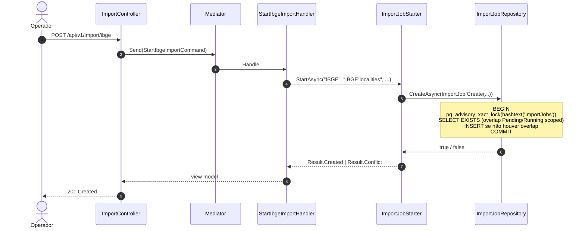
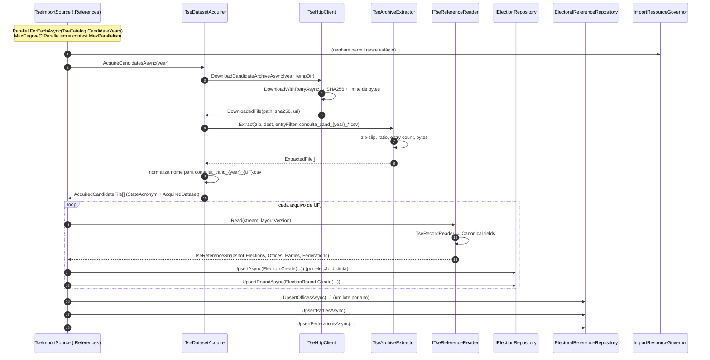
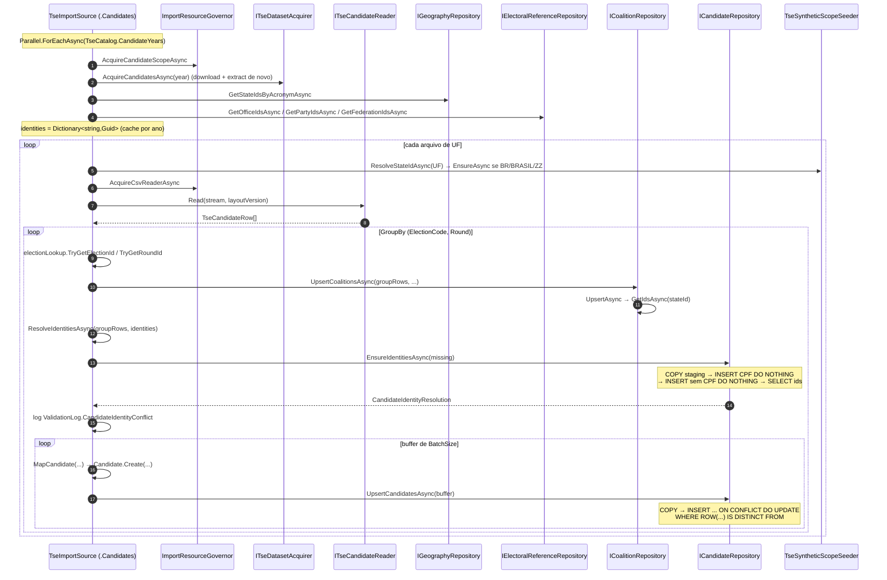
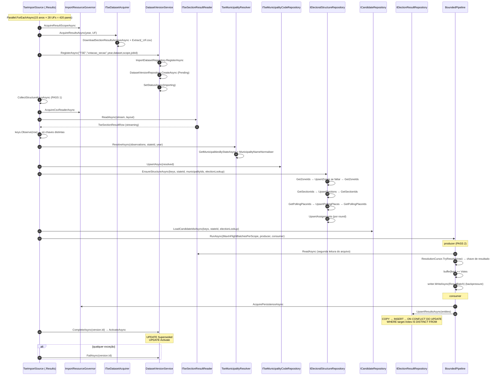

# Fluxos de Importação IBGE e TSE — Arquitetura Atual e Proposta

> Documento descritivo do estado atual do repositório `Bravo`, com diagramas das classes e
> métodos reais, e uma proposta de reorganização da camada Application.
>
> Nada da reorganização proposta aqui foi implementado. A única alteração de código feita nesta
> tarefa foi a correção de persistência de `CandidateIdentities` (ver
> `docs/architecture/database-write-audit.md`).
>
> Caminhos reais inspecionados: `src/Application/Bravo.Application/Importing/`,
> `src/Infrastructure/Bravo.Infrastructure.Ibge/`, `src/Infrastructure/Bravo.Infrastructure.Tse/`,
> `src/Infrastructure/Bravo.Infrastructure.PostgreSQL.Dapper/`,
> `src/Presentation/Bravo.Presentation/Workers/`.

---

## 0. Correção de premissa importante

A descrição da tarefa menciona **Work Units**, checkpoints por unidade de trabalho e
`Application/Imports/Sources/Ibge`. O código atual **não tem nada disso**:

- Não existe entidade `WorkUnit`, nem tabela, nem checkpoint por unidade. O modelo é **por job**.
  O próprio XML doc de `ImportJob` diz: *“Execution state lives here, at job level: there is no
  per-work-unit persistence, so an interrupted job is simply executed again from the start.”*
- Os diretórios reais são `Importing/Sources/Ibge` e `Importing/Sources/Tse` (não `Imports/Sources`).
- `PersistenceLog.CheckpointPersisted` (EventId 1404) ainda existe no código de logging, mas
  **nenhum chamador**. É código morto de uma versão anterior com work units.
- Os view models ainda usam o vocabulário “WorkUnits” (`ImportProgressWorkUnits`,
  `CurrentWorkUnit`), mas eles são derivados dos contadores do job
  (`GetImportJobProgressHandler.cs:38-45`), não de unidades persistidas.

`ImportMemoryProbe` (`Importing/Services/ImportMemoryProbe.cs`) também está sem chamador.

Este documento descreve o que existe, não o que os nomes sugerem.

---

## A. Visão geral da arquitetura atual

```text
┌──────────────────────────────────────────────────────────────────────────────┐
│ PRESENTATION                                                                 │
│                                                                              │
│  ImportController (api/v1/import)                                            │
│    POST /ibge ─┐                                                             │
│    POST /tse  ─┤                                                             │
│                └──► Mediator.Send(StartIbgeImportCommand | StartTseImportCommand)
│                                                                              │
│  ImportWorker : BackgroundService  (singleton)                               │
│    ├── RecoverAsync ──► ImportJobRecoveryService                             │
│    ├── PeriodicTimer(PollIntervalSeconds)                                    │
│    ├── DispatchAsync ──► IImportJobScheduler.ListRecoverableAsync            │
│    └── RunJobAsync ──► scope → Mediator.Send(ExecuteImportJobCommand)        │
└───────────────────────────────────┬──────────────────────────────────────────┘
                                    │
┌───────────────────────────────────▼──────────────────────────────────────────┐
│ APPLICATION — Importing                                                      │
│                                                                              │
│  Start*ImportHandler ──► ImportJobStarter.StartAsync ──► IImportJobRepository│
│                                                          .CreateAsync         │
│                                                          (advisory lock +    │
│                                                           overlap check)     │
│                                                                              │
│  ExecuteImportJobHandler ──► ImportJobExecutor.ExecuteAsync                  │
│    ├── jobs.ClaimAsync                (FOR UPDATE SKIP LOCKED)               │
│    ├── sources.FirstOrDefault(Key)    ← IEnumerable<IImportSource>           │
│    ├── ImportProgressSink                                     ▲              │
│    ├── ImportExecutionContext(job) ────────────────────────────┘             │
│    ├── HeartbeatAsync (lease + flush de progresso)                            │
│    ├── source.ExecuteAsync(context, token)                                   │
│    ├── jobs.CompleteAsync / FailAsync / ReleaseAsync                          │
│    └── ImportFailureClassifier + ImportRetryPolicy                            │
└──────────────┬────────────────────────────────────┬──────────────────────────┘
               │                                    │
      ┌────────▼─────────┐              ┌───────────▼────────────┐
      │ IbgeImportSource │              │ TseImportSource        │
      │ (IImportSource)  │              │ (IImportSource, 4      │
      │ 133 linhas       │              │  arquivos parciais,    │
      │                  │              │  ~1250 linhas)         │
      └────────┬─────────┘              └───────────┬────────────┘
               │                                    │
               │  IIbgeReader                       │ ITseDatasetAcquirer
               │                                    │ ITseReferenceReader
               │                                    │ ITseCandidateReader
               │                                    │ ITseSectionResultReader
               │                                    │ DatasetVersionService
               │                                    │ TseMunicipalityResolver
               │                                    │ TseSyntheticScopeSeeder
               │                                    │ ImportResourceGovernor
               │                                    │ 7 repositórios
               │                                    │
┌──────────────▼────────────────────────────────────▼──────────────────────────┐
│ INFRASTRUCTURE                                                               │
│                                                                              │
│  Bravo.Infrastructure.Ibge            Bravo.Infrastructure.Tse               │
│   IbgeReader (IIbgeReader)             TseDatasetAcquirer                     │
│   IbgeHttpClient                       TseHttpClient (download + SHA256)      │
│   IbgeRateLimiter                      TseArchiveExtractor                    │
│                                        TseReferenceReader                     │
│                                        TseCandidateReader                     │
│                                        TseSectionResultReader                 │
│                                        TseRecordReader → TseCsvFile           │
│                                        TseCsvReader → TseCsvRecordMapper       │
│                                                                              │
│  Bravo.Infrastructure.PostgreSQL.Dapper                                      │
│   CandidateRepository · ElectoralReferenceRepository                          │
│   ElectoralStructureRepository · ElectionResultRepository                     │
│   CoalitionRepository · ElectionRepository                                    │
│   GeographyLookup · TseMunicipalityCodeRepository                             │
│   ImportJobRepository · DatasetVersionRepository                              │
│   ImportDatasetRepository · ImportFailedRecordRepository                      │
│   Bulk/BulkCopy (único ponto de COPY + merge)                                 │
└───────────────────────────────────┬──────────────────────────────────────────┘
                                    ▼
                              PostgreSQL 16/17
```

### 0.1 Ordem de registro em DI

`src/Presentation/Bravo.Presentation/Program.cs`:

```csharp
builder.Services
    .AddDatabase(builder.Configuration)   // Dapper + EF + Ibge + Tse
    .AddApplication()                     // Mediator + handlers + services + IBGE source
    .AddImportWorker(builder.Configuration);
```

O detalhe importante: **`IImportSource` é registrado em dois lugares diferentes.**

- `ApplicationExtensions.AddApplicationServices()` registra `IbgeImportSource`
  (`src/Application/Bravo.Application/Extensions/ApplicationExtensions.cs:46`).
- `TseExtensions.AddTseServices()` — que vive no projeto **Infrastructure** — registra
  `TseImportSource` (`src/Infrastructure/Bravo.Infrastructure.Tse/Extensions/TseExtensions.cs:62`).

Isso é uma inversão de dependência: a Infrastructure é quem “instala” um serviço de Application.
Funciona porque `Bravo.Infrastructure.Tse` referencia `Bravo.Application`, mas é a raiz de metade
dos problemas de navegação descritos em §F.

---

## B. Sequência detalhada — IBGE

### B.1 Criação e dispatch



`ImportWorker` não participa da criação. Ele só descobre o job no próximo poll.

Observação: `StartIbgeImportHandler` usa **strings literais** `"IBGE"` e `"IBGE:localities"`
(`Handlers/StartIbgeImportHandler.cs:17-18`), enquanto `StartTseImportHandler` usa
`TseImportSource.SourceKey` / `.Scope` (`Handlers/StartTseImportHandler.cs:20-21`).
`IbgeImportSource` até declara `public const string SourceKey = "IBGE"`, mas o handler não o usa.

### B.2 Claim e execução

```mermaid
sequenceDiagram
    autonumber
    participant W as ImportWorker
    participant Sch as ImportJobScheduler
    participant M as Mediator
    participant E as ImportJobExecutor
    participant R as ImportJobRepository
    participant P as ImportProgressSink
    participant S as IbgeImportSource
    participant Rd as IbgeReader
    participant H as IbgeHttpClient
    participant G as GeographyLookup

    loop a cada PollIntervalSeconds
        W->>Sch: ListRecoverableAsync(MaxJobsPerPoll)
        Sch->>R: ListRecoverableIdsAsync
        R-->>W: [jobId...]
    end

    W->>W: _slots.WaitAsync(0) (MaxConcurrentJobs)
    W->>M: Send(ExecuteImportJobCommand(jobId, workerId))
    M->>E: ExecuteAsync

    E->>R: ClaimAsync(jobId, workerId, lease)
    Note over R: WITH claimable AS (SELECT ... FOR UPDATE SKIP LOCKED)<br/>UPDATE ImportJobs SET Status='Running', AttemptCount+1,<br/>Stage='Initializing', zera contadores<br/>RETURNING *
    R-->>E: ImportJob?

    alt job == null
        E-->>W: NotClaimed
    else fonte não registrada
        E->>R: CompleteAsync(Failed, "No import source ...")
    else
        E->>E: sources.FirstOrDefault(s => s.Key == job.Source)
        E->>P: new ImportProgressSink(jobs, jobId, workerId, ...)
        E->>E: new ImportExecutionContext(jobId, BatchSize, MaxParallelism, progress)
        E->>E: _ = HeartbeatAsync(...)

        E->>S: ExecuteAsync(context, executionCts.Token)
        activate S

        S->>S: context.Report(References, 2, 0, ...)
        S->>Rd: StreamStatesAsync(token)
        activate Rd
        Rd->>H: StreamStatesAsync  (GET api/v1/localidades/estados?orderBy=nome)
        H->>H: IbgeRateLimiter.AcquireAsync
        H-->>Rd: IAsyncEnumerable<IbgeEstadoDto?>
        Rd->>Rd: valida Sail/Region → State.Create(id, uf, nome, região)
        Rd-->>S: State? (null = descartado + ValidationLog)
        deactivate Rd

        loop buffer de BatchSize
            S->>G: UpsertStatesAsync(batch)
            G->>G: COPY staging_states → INSERT ... ON CONFLICT ("Abbreviation")<br/>DO UPDATE ... WHERE ROW(Name,Region) IS DISTINCT FROM
            G-->>S: afetados
        end

        alt nenhum estado observado
            S-->>E: ImportPermanentException("IBGE returned no states.")
        end

        S->>S: context.Report(References, 2, 1, ..., municipalities)
        S->>Rd: StreamMunicipalitiesAsync(token)
        Rd->>H: GET api/v1/localidades/municipios?orderBy=nome
        H-->>Rd: IAsyncEnumerable<IbgeMunicipalityDto?>
        Rd->>Rd: GetStateCode(microRegiao.mesoRegiao.uf ?? regiaoImediata.regiaoIntermediaria.uf)
        Rd-->>S: MunicipalityUpsert(ibgeCode, nome, stateIbgeCode)

        loop buffer de BatchSize
            S->>G: UpsertMunicipalitiesAsync(batch)
            G->>G: COPY → INSERT ... SELECT ... JOIN States ON IbgeCode<br/>ON CONFLICT ("IbgeCode") DO UPDATE ... WHERE ROW(Name,StateId) IS DISTINCT FROM
            G->>G: SELECT COUNT(*) do staging JOIN States
            G-->>S: casados
        end

        alt casados < buffer.Count
            S-->>E: ImportPermanentException("some states are missing")
        end

        S->>S: context.Report(Persisting, 2, 2, ...)
        S-->>E: (retorno)
        deactivate S

        E->>P: FlushAsync
        E->>R: GetAsync(jobId)  (para ler TotalFailedRecords)
        E->>R: CompleteAsync(Completed | CompletedWithErrors)
        E->>E: executionCts.Cancel(); await heartbeat
    end
```

### B.3 Onde cada responsabilidade realmente está

| Etapa | Classe e método | Camada real |
|---|---|---|
| Criação do job | `ImportJobStarter.StartAsync` | Application |
| Regra de não sobreposição | `ImportJobRepository.CreateAsync` (advisory lock + `EXISTS`) | Infrastructure (SQL) |
| Poll | `ImportWorker.DispatchAsync` → `ImportJobScheduler.ListRecoverableAsync` | Presentation → Application |
| Claim e lease | `ImportJobRepository.ClaimAsync` | Infrastructure (SQL) |
| Seleção da fonte | `ImportJobExecutor.ExecuteAsync:65` | Application |
| Heartbeat | `ImportJobExecutor.HeartbeatAsync` | Application |
| Throttle de progresso | `ImportProgressSink` | Application |
| Classificação de falha | `ImportFailureClassifier` | Application |
| Backoff | `ImportRetryPolicy` | Application |
| URL do endpoint IBGE | `IbgeHttpClient.StatesRequestUri` / `MunicipalitiesRequestUri` | **Infrastructure** ✅ |
| Rate limit IBGE | `IbgeRateLimiter` | Infrastructure ✅ |
| Decodificação JSON streaming | `IbgeHttpClient.StreamAsync` (`DeserializeAsyncEnumerable`) | Infrastructure ✅ |
| Decisão “quais campos são obrigatórios” | `IbgeReader.StreamStatesAsync` | **Infrastructure** ⚠️ |
| `State.Create` / `MunicipalityUpsert` | `IbgeReader` | **Infrastructure** ⚠️ |
| Ordenação e tamanho de lote | `IbgeImportSource.ImportStatesAsync` | Application ✅ |
| Regra “escrita curta é falha permanente” | `IbgeImportSource.PersistMunicipalitiesAsync` | Application ✅ |
| Progresso por estágio | `IbgeImportSource.ExecuteAsync` | Application ✅ |

O IBGE é, hoje, o fluxo mais bem separado dos dois. O desvio é `IbgeReader` mapear DTO → entidade de
domínio dentro da Infrastructure. A interface `IIbgeReader` está declarada em
`src/Application/Bravo.Application/Importing/Sources/Ibge/IIbgeReader.cs`, e a implementação em
`src/Infrastructure/Bravo.Infrastructure.Ibge/Importing/IbgeReader.cs` — ou seja, a Application
manda na abstração e a Infrastructure implementa. Isso está correto; o que está no lugar errado é
apenas a *transformação* de validação para domínio.

---

## C. Sequência detalhada — TSE

### C.1 Topo: `TseImportSource.ExecuteAsync`

```csharp
// src/Application/Bravo.Application/Importing/Sources/Tse/TseImportSource.cs:38-50
await ImportReferencesAsync(context, cancellationToken);
var electionLookup = await TseElectionLookup.LoadAsync(elections, cancellationToken);
await ImportCandidatesAsync(context, electionLookup, cancellationToken);
await ImportResultsAsync(context, electionLookup, cancellationToken);
```

Três estágios sequenciais, cada um paralelizando internamente com `Parallel.ForEachAsync`.

### C.2 Estágio 1 — Referências



Detalhe importante: **o mesmo arquivo de candidatos é baixado e extraído neste estágio e de novo no
estágio de candidatos**. `TseDatasetAcquirer` não tem cache entre chamadas; cada
`AcquireCandidatesAsync(year)` cria `cand-{year}-{guid}` e baixa o `.zip` de novo. Portanto o
arquivo de candidatos de cada ano é transferido e descompactado **duas vezes por job**. Isso é
volume de rede e I/O, não escrita em banco, mas é o tipo de acoplamento que a reorganização deveria
resolver (uma etapa de aquisição compartilhada).

### C.3 Estágio 2 — Candidatos



Problema de concorrência real aqui: `identities` é um `Dictionary<string, Guid>` **mutável,
compartilhado entre estados**, mas os estados são processados **sequencialmente dentro de um ano**
(`foreach (var file in files)`), então não há corrida dentro de um ano. Anos diferentes rodam em
paralelo, mas têm caches separados. A serialização entre anos é feita pelo índice único do banco,
que é exatamente o que a correção de `CandidateIdentities` preserva.

### C.4 Estágio 3 — Resultados



### C.5 Relação entre infraestrutura compartilhada e orquestração por fonte

- **Compartilhado**: `IImportSource`, `ImportJobExecutor`, `ImportExecutionContext`,
  `ImportProgressSink`, `ImportRetryPolicy`, `ImportFailureClassifier`, `ImportResourceGovernor`,
  `BoundedPipeline`, `BulkCopy`.
- **Específico de TSE**: toda a orquestração dos três estágios, o catálogo de anos/UFs, o lookup de
  eleições, as chaves de estrutura, o resolvedor de municípios, o seeder de escopos sintéticos e o
  `DatasetVersionService`.
- **Infraestrutura de TSE**: download HTTP, extração de ZIP, leitura de CSV, layouts, parsing de
  valores, backoff.

O `TseImportSource` **é** a orquestração, mas ela está espalhada em 4 arquivos parciais que somam
~1250 linhas e misturam orquestração de aplicação com decisões de formato e de resolução.

---

## D. Decomposição de responsabilidades

| Componente | Responsabilidade atual | Camada atual | Avaliação |
|---|---|---|---|
| `ImportController` | Expor endpoints e traduzir para comandos | Presentation | OK |
| `ImportWorker` | Poll, cap de concorrência, dispatch, recuperação no boot | Presentation | OK — é agendador, não executor |
| `ImportJobScheduler` | Adaptar repositório para o worker | Application | OK, mas é um wrapper de 1 linha |
| `ImportJobStarter` | Criar job, esconder regra de overlap | Application | OK, pequeno |
| `ImportJobExecutor` | Claim, heartbeat, execução, settle, retry | Application | **Grande e com 4 responsabilidades**: ciclo de vida do job, lease, progresso e classificação de falha |
| `ImportProgressSink` | Throttle + serialização de progresso | Application | OK, mas é infraestrutura de observabilidade |
| `ImportResourceGovernor` | Semáforos globais de recursos | Application | **Misplaced**: é infraestrutura de processo, não regra de aplicação |
| `BoundedPipeline` | Producer/consumer com backpressure | Application | **Misplaced**: utilitário de runtime |
| `ImportMemoryProbe` | Snapshot de GC | Application | **MortO** (sem chamador) |
| `ImportFailureClassifier` | Mapear exceção → transiente/permanente | Application | OK |
| `ImportRetryPolicy` | Backoff exponencial com jitter | Application | OK |
| `IbgeImportSource` | Orquestração de 2 estágios | Application | OK |
| `IIbgeReader` | Abstração de aquisição | Application | OK |
| `IbgeReader` | Aquisição + validação + mapeamento para domínio | **Infrastructure** | **Mistura aquisição com regra de domínio** |
| `IbgeHttpClient` | Endpoint, rate limit, JSON streaming | Infrastructure | OK |
| `TseImportSource` (4 parciais) | 3 estágios, paralelismo, estrutura, resolução, mapeamento | Application | **Maior problema da solução** (ver §F) |
| `TseCatalog` | Anos e UFs hardcoded | Application | Discutível: é dado de fonte, poderia ser Infrastructure |
| `TseElectionLookup` | Snapshot imutável de eleições | Application | OK |
| `TseStructureKeys` | Agregação de chaves geográficas | Application | OK, mas é modelo de parsing |
| `TseStructureIds` | Mapas de IDs por estado | Application | OK |
| `TseMunicipalityResolver` | Match nome normalizado → município IBGE | Application | **Regra de domínio em Application** |
| `TseSyntheticScopeSeeder` | Criar estados sintéticos BR/BRASIL/ZZ | Application | Regra de domínio plausível, mas faz I/O |
| `DatasetVersionService` | Registrar/ativar/falhar versão de dataset | Application | OK |
| `TseDatasetAcquirer` | Download + extração + naming | Infrastructure | OK |
| `TseHttpClient` | URL, download, SHA256, retry, limites | Infrastructure | OK, mas tem código comentado e `todo: refactor this trash` |
| `TseArchiveExtractor` | ZIP com defesas | Infrastructure | OK |
| `TseReferenceReader` / `TseCandidateReader` / `TseSectionResultReader` | CSV → modelos de domínio | Infrastructure | **Mapeiam para tipos de `Domain.Electoral.Models`** — acoplamento aceitável mas notável |
| `TseRecordReader` / `TseCsvFile` / `TseCsvReader` / `TseCsvRecordMapper` | CSV de baixo nível + header mapping | Infrastructure | OK |
| `CandidateRepository` | Persistência + resolução de identidade | Infrastructure | OK (após a correção) |
| `GeographyLookup` | Upsert e lookup de estados/municípios | Infrastructure | OK, mas o nome sugere leitura apenas |
| `ElectionRepository` | Upsert/listagem | Infrastructure | OK |
| `PostgreSQLContext` | Modelo EF Core | Infrastructure | Coexiste com Dapper; usado só por Users/Auth |

### Classes excessivamente grandes

| Classe | Linhas | Por que é grande |
|---|---|---|
| `TseImportSource.Results.cs` | 460 | 3 estágios (aquisição, estrutura, streaming), `ResolutionCursor` como struct aninhada, `ResultBatch`, agregação de votos, resolução de municípios, resolução de candidatos, ativação de versão |
| `TseImportSource.Candidates.cs` | 383 | Paralelismo por ano, leitura por estado, agrupamento por eleição/round, upsert de coalizões, resolução de identidades, buffer de candidatos, resolução de estado sintético |
| `TseImportSource` (parcial principal) | 51 | Só o construtor: **19 dependências injetadas**, das quais 7 são repositórios |
| `TseImportSource.Structure.cs` | 217 | 4 `Ensure*Async` + heurística `FirstMunicipalityInZone` |
| `TseImportSource.References.cs` | 143 | Paralelismo + leitura de todos os arquivos + upserts |
| `ImportJobRepository` | 432 | 9 SQL de `UPDATE` + claim + parâmetros |
| `ElectoralStructureRepository` | 352 | 4 pares staging/merge + 3 leituras |

O construtor de `TseImportSource` é o sintoma mais claro:

```csharp
// TseImportSource.cs:13-30
public sealed partial class TseImportSource(
    ITseDatasetAcquirer acquirer,
    ITseReferenceReader referenceReader,
    ITseCandidateReader candidateReader,
    ITseSectionResultReader sectionReader,
    IElectionRepository elections,
    IElectoralReferenceRepository reference,
    ICoalitionRepository coalitions,
    ICandidateRepository candidates,
    IElectoralStructureRepository structure,
    IElectionResultRepository results,
    IGeographyRepository geography,
    ITseMunicipalityCodeRepository municipalityCodes,
    TseMunicipalityResolver municipalityResolver,
    TseSyntheticScopeSeeder syntheticScopes,
    DatasetVersionService datasetVersions,
    ImportResourceGovernor resources,
    ILogger<TseImportSource> logger) : IImportSource
```

Uma classe que precisa de 7 repositórios, 4 leitores, 2 serviços de resolução e um governador não
tem uma responsabilidade; tem cinco.

---

## E. Mapa de dependências

### E.1 Application → abstrações

| Classe de Application | Depende de | Origem da abstração |
|---|---|---|
| `IbgeImportSource` | `IIbgeReader`, `IGeographyRepository`, `ILogger` | Application / Domain |
| `TseImportSource` | `ITseDatasetAcquirer` | **Domain** (`Domain/Electoral/Services`) |
| | `ITseReferenceReader`, `ITseCandidateReader`, `ITseSectionResultReader` | **Domain** |
| | `IElectionRepository`, `IElectoralReferenceRepository`, `ICoalitionRepository`, `ICandidateRepository`, `IElectoralStructureRepository`, `IElectionResultRepository` | Domain |
| | `IGeographyRepository`, `ITseMunicipalityCodeRepository` | Domain |
| | `TseMunicipalityResolver`, `TseSyntheticScopeSeeder`, `DatasetVersionService` | Application |
| | `ImportResourceGovernor` | Application |
| `ImportJobExecutor` | `IImportJobRepository`, `IEnumerable<IImportSource>`, `ImportRetryPolicy`, `IOptions<ImportEngineOptions>` | Domain / Application |
| `ImportProgressSink` | `IImportJobRepository`, `IOptions<ImportEngineOptions>` | Domain / Application |
| `DatasetVersionService` | `IImportDatasetRepository`, `IDatasetVersionRepository` | Domain |
| `TseMunicipalityResolver` | `IGeographyRepository` | Domain |
| `TseSyntheticScopeSeeder` | `IGeographyRepository` | Domain |

### E.2 Violações de fronteira reais

1. **`IIbgeReader` está em Application, não em Domain.** `IbgeImportSource` (Application) depende de
   `IIbgeReader` (Application). Isso é internamente coerente, mas quebra a convenção do projeto:
   todas as outras abstrações de leitura (`ITseDatasetAcquirer`, `ITse*Reader`) estão em
   `Domain/Electoral/Services`. Há duas convenções convivendo.

2. **`TseExtensions` (Infrastructure) registra `TseImportSource` (Application).** A Infrastructure
   conhece e instala uma classe de orquestração da Application. Isso também faz a Infrastructure
   depender de `ImportResourceOptions` e `ImportEngineOptions`, que são opções de Application.

3. **`Bravo.Infrastructure.PostgreSQL.Dapper` referencia `Bravo.Application`.** O `.csproj` inclui
   `ProjectReference` para Application. Um repositório não deveria precisar da camada de aplicação.

4. **`TseReferenceReader`/`TseCandidateReader`/`TseSectionResultReader` (Infrastructure) produzem
   `Bravo.Domain.Electoral.Models.TseCandidateRow` e `TseSectionResultRow`.** A modelagem de linha
   (“o que é um candidato do TSE”) está em Domain, mas o formato (“como está no CSV”) é
   Infrastructure. Funciona, mas significa que adicionar uma coluna ao CSV mexe em Domain.

5. **`ImportResourceGovernor` e `BoundedPipeline` são dependências de Application que são
   infraestrutura de processo.** `TseImportSource` chama `resources.AcquireCsvReaderAsync` e
   `BoundedPipeline.RunAsync` diretamente nas regras de negócio.

6. **`IbgeReader` faz validação de domínio.** `if (string.IsNullOrWhiteSpace(item.Sail) || ...)`
   em `IbgeReader.cs:35` é uma regra de “o que é um estado válido”, não uma regra de transporte.

---

## F. Problemas arquiteturais concretos

### F.0 Defeito pré-existente encontrado durante a validação (não corrigido)

`TseHttpClient.CopyWithChecksumAsync`
(`src/Infrastructure/Bravo.Infrastructure.Tse/Clients/TseHttpClient.cs:175-200`) declara
`long total = 0`, mas a alteração de trabalho em andamento removeu a linha que acumulava o
tamanho (`total = EnsureWithinLimit(total + read)`). Como resultado **`total` nunca é incrementado e
`SizeBytes` é sempre 0**.

Impacto: `DownloadsFileAndComputesSha256` em `tests/Bravo.UnitTests/Tse/TseHttpClientTests.cs`
falha com `Expected result.SizeBytes to be 8L, but found 0L`. Confirmado que a falha é do arquivo
em edição e não desta tarefa: restaurando temporariamente a acumulação, a suíte unitária passa
166/166.

Consequência de negócio: `ImportDataset.SizeBytes` é gravado como 0 para todo dataset TSE, o que
também desativa de fato o limite `MaxDownloadBytes` (o método `EnsureWithinLimit` está com o corpo
comentado, retornando sempre o valor recebido). Isso deve ser corrigido antes de qualquer trabalho
de reorganização, mas **não foi tocado** nesta tarefa porque está fora do escopo autorizado.

### F.1 `TseImportSource` é quatro classes com o mesmo nome

Os arquivos parciais não são “pedaços de uma classe coesa”; são quatro estágios independentes que
compartilham o construtor. Consequências concretas:

- Para entender o import de candidatos é preciso ler `TseImportSource.cs` (construtor),
  `TseImportSource.References.cs` (para saber o que já foi gravado antes),
  `TseImportSource.Candidates.cs` (o estágio) e `TseImportSource.Structure.cs` **não** se aplica, mas
  `TseStructureKeys` e `TseElectionLookup` são pré-requisitos implícitos. Não há como ver a sequência
  em um arquivo.
- `MapCandidate` é `static` e recebe 9 parâmetros posicionais, incluindo três dicionários de IDs
  diferentes (`officeIds`, `partyIds`, `federationIds`) e um `Dictionary<string, Guid>` mutável
  (`identities`). Um erro de ordem de parâmetro compila.
- `Resolve` (helper de lookup que lança) está em `TseImportSource.Candidates.cs:361` mas é usado
  apenas ali; `ResolveStateIdAsync` (`:370`) e `ResolveResultStateIdAsync` (`Results.cs:363`) fazem
  a mesma coisa com nomes diferentes e sem compartilhar código.

### F.2 O mesmo dado é adquirido duas vezes

`ImportReferencesAsync` chama `acquirer.AcquireCandidatesAsync(year)`
(`References.cs:67`) e `ImportCandidatesAsync` chama de novo
(`Candidates.cs:92`). Cada chamada baixa o ZIP e extrai todos os CSVs em um diretório novo. Isso
existe porque o estágio de referências precisa ler os mesmos arquivos antes do estágio de
candidatos, e não há um cache/escopo de aquisição. É um vazamento de uma decisão de infraestrutura
para dentro da orquestração: a Application está coordenando *quando* baixar.

### F.3 Progresso é escrito, mas nunca é lido pela orquestração

`ImportProgressSink` grava `TotalOperations`, `CompletedOperations`, `FailedOperations`,
`TotalProcessedRecords`, `TotalFailedRecords`, `CurrentOperation`. Mas:

- Nenhum estágio TSE incrementa `FailedRecords` ou grava em `ImportFailedRecords`. O pipeline
  simplesmente ignora linhas que não resolvem (`ResolutionCursor.TryResolve` retorna `false`) e não
  registra nada. Logo `TotalFailedRecords` é sempre 0 no TSE, e
  `ImportJobExecutor` nunca classifica o job como `CompletedWithErrors` por causa do TSE.
- `context.Report` no TSE é chamado com contadores absolutos que são `Interlocked` sobre variáveis
  locais; está correto, mas a granularidade é “por par ano/UF”, não por registro.

Isso significa que o mecanismo de progresso existe e funciona, mas o de **falhas** existe só no
papel, para o TSE.

### F.4 Três modelos de paralelismo concorrentes

No mesmo fluxo convivem:

1. `Parallel.ForEachAsync` com `context.MaxParallelism` (por estágio);
2. `ImportResourceGovernor` com 5 semáforos globais independentes
   (`MaxConcurrentResultScopes`, `MaxConcurrentCandidateScopes`, `MaxConcurrentExtractions`,
   `MaxConcurrentCsvReaders`, `MaxConcurrentPersistenceOperations`);
3. `BoundedPipeline` com `MaxInFlightBatchesPerScope`.

Nenhum deles conhece o outro. O limite efetivo de memória é o produto dos três, e não há um lugar
único que diga “no máximo N arquivos abertos”. O comentário de `ImportResourceOptions` reconhece o
problema (“a job's own parallelism is not a safe memory bound”), mas a solução foi adicionar um
segundo mecanismo, não unificar.

### F.5 Configuração espalhada por três camadas

- `ImportEngineOptions` (`SectionName = "Importing"`) é ligada em
  `ImportWorkerExtensions` (**Presentation**).
- `ImportResourceOptions` (`"Importing:Resources"`) é ligada em `TseExtensions` (**Infrastructure**).
- `ImportWorkerOptions` (`"Importing:Worker"`) é ligada em `ImportWorkerExtensions` (Presentation).
- `TseOptions` e `IbgeOptions` em seus próprios projetos.

Três camadas diferentes precisam concordar sobre o prefixo `Importing`. Não há validação cruzada.

### F.6 Vocabulário morto

`ImportStage` tem 15 valores; o TSE usa 3 (`References`, `Candidates`, `Results`), o IBGE usa 2
(`References`, `Persisting`). `Downloading`, `Extracting`, `Reading`, `Parsing`, `Validating`,
`Normalizing`, `Finalizing`, `Failed` nunca são reportados. `PersistenceLog.CheckpointPersisted` e
`ImportMemoryProbe` não têm chamador. `IImportJobRepository` e `DatasetVersionRepository` ainda têm
métodos que parecem de uma versão anterior.

### F.7 Comentários que documentam dívida

- `TseImportSource.cs:12` — `///Trash, destroys the simplicity of the project`
- `IbgeImportSource.cs:13` — `///heavily trashed. Probably would make much more sense at infra.`
- `ImportJobRepository.cs:10` — `///this one could be a EF Core repo`
- `TseHttpClient.cs:13` — `/// todo: refactor this trash`
- `ImportEngineOptions.cs:6` — `/// i dont thinks that needs to be configured but anyways, not bad at all`
- `IElectoralReferenceRepository.cs` — `//todo: using tuples at interfaces are almost an antipattern`

Os autores já identificaram os problemas. O que falta é uma direção de reorganização — que é o
objeto de §G.

---

## G. Proposta de reorganização

### G.1 Estrutura final proposta

```text
src/Application/Bravo.Application/Imports/
│
├── Common/
│   ├── Abstractions/
│   │   ├── IImportSource.cs                 (movido de Domain/Importing/Services)
│   │   ├── IImportStage.cs                  (novo: contrato de um estágio)
│   │   └── IImportProgressReporter.cs       (extraído de ImportExecutionContext)
│   ├── Models/
│   │   ├── ImportExecutionContext.cs
│   │   ├── ImportJobProgress.cs
│   │   └── ImportRejectedRecord.cs
│   ├── Execution/
│   │   ├── ImportJobExecutor.cs             (dividido, ver G.4)
│   │   ├── ImportJobClaimService.cs
│   │   ├── ImportHeartbeatService.cs
│   │   └── ImportJobStarter.cs
│   ├── Policies/
│   │   ├── ImportRetryPolicy.cs
│   │   └── ImportFailureClassifier.cs
│   └── Progress/
│       ├── ImportProgressSink.cs
│       └── ImportProgressPublisher.cs
│
├── Ibge/
│   ├── Abstractions/
│   │   └── IIbgeDataAcquirer.cs             (renomeado de IIbgeReader)
│   ├── Models/
│   │   └── IbgeStateRecord.cs, IbgeMunicipalityRecord.cs  (opcional)
│   ├── Services/
│   │   └── IbgeReferenceImporter.cs
│   ├── Commands/
│   │   └── StartIbgeImportCommand.cs        (movido)
│   ├── Handlers/
│   │   ├── StartIbgeImportHandler.cs        (movido)
│   │   └── ExecuteIbgeImportHandler.cs      (novo: só IBGE)
│   └── IbgeImportSource.cs                  (fachada fina, ~40 linhas)
│
└── Tse/
    ├── Abstractions/
    │   ├── ITseDatasetAcquirer.cs
    │   ├── ITseReferenceReader.cs
    │   ├── ITseCandidateReader.cs
    │   └── ITseSectionResultReader.cs
    ├── Models/
    │   ├── TseCatalog.cs
    │   ├── TseElectionLookup.cs
    │   ├── TseStructureKeys.cs
    │   ├── TseStructureIds.cs
    │   ├── TseScopes.cs
    │   └── TseSectionResultRow.cs, TseCandidateRow.cs
    ├── Services/
    │   ├── TseReferenceImporter.cs
    │   ├── TseCandidateImporter.cs
    │   ├── TseResultImporter.cs
    │   ├── TseStructurePreparer.cs
    │   ├── TseMunicipalityResolver.cs
    │   ├── TseSyntheticScopeSeeder.cs
    │   └── DatasetVersionService.cs
    ├── Commands/
    │   ├── StartTseImportCommand.cs
    │   └── ImportTseCandidatesCommand.cs       (opcional, por estágio)
    ├── Handlers/
    │   ├── StartTseImportHandler.cs
    │   └── ExecuteTseImportHandler.cs
    └── TseImportSource.cs                      (fachada fina, ~50 linhas)
```

### G.2 Responsabilidades por módulo

| Módulo | Responsabilidade | Não faz |
|---|---|---|
| `Imports/Common/Execution` | Ciclo de vida do job: claim, heartbeat, settle, retry, recuperação | Não conhece IBGE nem TSE |
| `Imports/Common/Policies` | Classificar falha e calcular backoff | Não executa nada |
| `Imports/Common/Progress` | Throttle e persistência de progresso | Não decide o que reportar |
| `Imports/Ibge` | Orquestrar aquisição → validação → persistência de estados e municípios | Não fala HTTP, não escreve SQL |
| `Imports/Tse` | Orquestrar referências → candidatos → resultados, com seus estágios internos | Não fala HTTP, não abre ZIP, não lê CSV |
| `Infrastructure.Ibge` | Endpoint, rate limit, JSON, DTOs, mapeamento DTO → contrato | Não decide ordem nem lote |
| `Infrastructure.Tse` | Download, extração, CSV, layouts, parsing, mapeamento → contrato | Não decide estágios |
| `Infrastructure.PostgreSQL.Dapper` | SQL, COPY, merge, resolução de IDs | Não decide política |
| `Domain` | Entidades, invariantes, chaves naturais (`CandidateIdentityKey`), modelos de referência | Não orquestra |

### G.3 Classes que devem se mover

| Classe | De | Para |
|---|---|---|
| `IIbgeReader` | `Application/Importing/Sources/Ibge` | `Application/Imports/Ibge/Abstractions/IIbgeDataAcquirer` |
| `IbgeImportSource` | `Application/Importing/Sources/Ibge` | `Application/Imports/Ibge/IbgeImportSource` (enxuto) |
| `IbgeReader` | `Infrastructure.Ibge/Importing` | Mantém, mas devolve **contratos de Application**, não entidades de Domain |
| `TseImportSource.*` | `Application/Importing/Sources/Tse` | `Application/Imports/Tse/Services/Tse*Importer` (ver G.4) |
| `TseCatalog`, `TseElectionLookup`, `TseStructureKeys`, `TseStructureIds` | `Sources/Tse` | `Imports/Tse/Models` |
| `TseScopes` | `Application/Electoral/Models` | `Imports/Tse/Models` (é conhecimento de fonte, não de eleição) |
| `DatasetVersionService` | `Application/Electoral/Services` | `Imports/Common` ou `Imports/Tse/Services` |
| `ImportResourceGovernor`, `BoundedPipeline` | `Application/Importing/Services` | `Infrastructure` (são runtime, não regra) |
| `StartIbgeImportCommand`, `StartTseImportCommand` + handlers | `Importing/Commands`, `Importing/Handlers` | `Imports/Ibge/Commands`, `Imports/Tse/Commands` |
| `ExecuteImportJobCommand` + handler | `Importing/Commands` | `Imports/Common/Execution` |
| `GetImportJob*` / `ListImportFailedRecords*` | `Importing/Queries` | `Imports/Common/Queries` |

### G.4 Classes que devem ser divididas

**`TseImportSource` → 4 classes + 1 fachada**

| Nova classe | Sai de | Responsabilidade |
|---|---|---|
| `TseImportSource` (fachada) | `TseImportSource.cs` | Só `ExecuteAsync`: referências → lookup → candidatos → resultados. ~50 linhas. |
| `TseReferenceImporter` | `TseImportSource.References.cs` | Um estágio: por ano, adquirir, ler snapshot, upsert eleições/cargos/partidos/federações. |
| `TseCandidateImporter` | `TseImportSource.Candidates.cs` | Por ano/UF: ler, agrupar, coalizões, identidades, `Candidate.Create`, upsert. |
| `TseResultImporter` | `TseImportSource.Results.cs` | Por (ano, UF): dataset version, pass 1, estrutura, pass 2, flush. |
| `TseStructurePreparer` | `TseImportSource.Structure.cs` | `EnsureZones/Sections/PollingPlaces/Assignments` + `FirstMunicipalityInZone`. |
| `TseResultRowResolver` | `ResolutionCursor` (struct aninhada) | Resolver uma linha para a chave de resultado. Classe testável isoladamente. |

Isso não é “mover classes grandes para handlers grandes”: cada nova classe tem **uma** razão para
mudar e recebe **só** as dependências do seu estágio. `TseReferenceImporter` precisa de 1 leitor e
3 repositórios, não de 17 dependências.

**`ImportJobExecutor` → 3 classes**

| Nova classe | Responsabilidade |
|---|---|
| `ImportJobClaimService` | `ClaimAsync` + `RenewLeaseAsync` + tratamento de lease perdido |
| `ImportHeartbeatService` | Timer, flush de progresso, renovação, cancelamento por lease |
| `ImportJobExecutor` | Orquestrar: claim → executar fonte → settle (usa os dois acima) |

**`ImportJobRepository`** — não é preciso dividir a classe, mas os 9 `UPDATE` merecem um
`JobStateTransition` com o SQL agrupado por transição (`Claim`, `Renew`, `Report`, `Complete`,
`Fail`, `Cancel`, `Requeue`, `Release`), e guardas de no-op onde fizer sentido (ver auditoria §5.2).

### G.5 Classes que devem ser fundidas ou removidas

| Ação | Alvo | Motivo |
|---|---|---|
| Remover | `ImportMemoryProbe` | Sem chamador |
| Remover | `PersistenceLog.CheckpointPersisted` | Sem chamador, vocabulário de work unit morto |
| Remover | `ImportProgressWorkUnits` / `CurrentWorkUnit` | Renomear para `Progress`/`CurrentOperation`, refletindo o modelo por job |
| Fundir | `ResolveStateIdAsync` + `ResolveResultStateIdAsync` | Duplicados |
| Fundir | `TseImportSource.Resolve` (lookup com throw) em um `IdMap<TKey>` reutilizável | Usado 4 vezes |
| Extrair de `IbgeReader` | validação → `IbgeStateValidator` ou domínio | Infrastructure não decide invariante |
| Remover | `ImportStage` valores não usados, ou passar a reportá-los | Vocabulário morto |
| Manter | `TseCatalog` como dado de fonte | Legítimo |

### G.6 Interfaces compartilhadas em `Imports.Common`

- `IImportSource` — o contrato que o executor conhece. **Deve continuar em `Domain`** se você quiser
  que o executor não dependa de Application; caso contrário, mover para `Common/Abstractions`.
  Recomendação: **manter em `Domain/Importing/Services`**, porque não tem nada de Application e é
  usado pelo executor.
- `IImportProgressReporter` — hoje `IProgress<ImportExecutionContext.OperationProgress>`. Um
  contrato nomeado permite trocar a implementação sem tocar nos importers.
- `IImportStageRunner` (novo) — `Task<int> RunAsync(ImportExecutionContext, CancellationToken)`.
  Cada `Tse*Importer` implementa; a fachada compõe. Isso permite testar um estágio isolado.
- `IImportJobLifecycle` — claim/renew/settle para `ImportJobExecutor`, escondendo o repositório.

### G.7 Interfaces que permanecem específicas da fonte

- `IIbgeDataAcquirer` (`Application/Imports/Ibge/Abstractions`) — o IBGE não compartilha nada com o
  TSE além de `IImportSource`.
- `ITseDatasetAcquirer`, `ITseReferenceReader`, `ITseCandidateReader`, `ITseSectionResultReader`
  (`Application/Imports/Tse/Abstractions`).
- `ITseMunicipalityMatcher` se você quiser testar o resolver sem repositório.

### G.8 Serviços que pertencem à Infrastructure

| Serviço | Onde deve ficar |
|---|---|
| `IbgeHttpClient` | Infrastructure.Ibge (já está) |
| `IbgeRateLimiter` | Infrastructure.Ibge (já está) |
| `TseHttpClient` | Infrastructure.Tse (já está) |
| `TseArchiveExtractor` | Infrastructure.Tse (já está) |
| `TseCsvFile` / `TseCsvReader` / `TseCsvRecordMapper` / `TseRecordReader` | Infrastructure.Tse (já estão) |
| `Tse*Reader` | Infrastructure.Tse (já estão) |
| `ImportResourceGovernor` | **mover** de Application para Infrastructure (semáforos de processo) |
| `BoundedPipeline` | **mover** de Application para Infrastructure (utilitário de runtime) |
| `ImportProgressSink` | Manter em Application — é política de quando persistir |
| `BulkCopy` | Infrastructure (já está) |
| Todos os repositórios | Infrastructure (já estão) |

### G.9 Como `IImportSource` se encaixa

`IImportSource` é a única abstração que o `ImportJobExecutor` precisa. Ela deve continuar sendo a
**fachada do módulo da fonte**:

```csharp
public interface IImportSource
{
    string Key { get; }
    Task ExecuteAsync(ImportExecutionContext context, CancellationToken cancellationToken);
}
```

A fachada `TseImportSource` implementa compondo os estágios:

```csharp
public sealed class TseImportSource(
    TseReferenceImporter references,
    TseCandidateImporter candidates,
    TseResultImporter results) : IImportSource
{
    public const string SourceKey = "TSE";
    public const string Scope = "TSE:electoral";
    public string Key => SourceKey;

    public async Task ExecuteAsync(ImportExecutionContext context, CancellationToken ct)
    {
        await references.RunAsync(context, ct);

        var lookup = await TseElectionLookup.LoadAsync(/* IElectionRepository */, ct);

        await candidates.RunAsync(context, lookup, ct);
        await results.RunAsync(context, lookup, ct);
    }
}
```

Note que a fachada ainda precisa de acesso ao lookup. Duas opções: (a) `TseElectionLookup` é
construído dentro do importer de referências e devolvido como resultado; (b) um
`TseElectionLookupProvider` injetado. Recomendo (a) — o estágio de referências é o único que
escreve eleições, então ele é o dono natural do snapshot.

### G.10 MediatR (Mediator) no modelo de execução de jobs

**O que já existe e funciona:**

- `StartIbgeImportCommand` / `StartTseImportCommand` → handlers → `ImportJobStarter`.
  **Este é o uso correto**: um comando por caso de uso, síncrono, na borda HTTP.
- `ExecuteImportJobCommand` → `ExecuteImportJobHandler` → `ImportJobExecutor`. Aqui o Mediator é
  usado apenas como transporte interno do worker. Funciona, mas **não adiciona nada**: não há
  validação, não há pipeline, não há notificação, e o handler é um repasse de uma linha. O worker
  poderia resolver `ImportJobExecutor` diretamente do escopo. Mantenha se você quiser simetria e
  ponto único de instrumentação; remova se quiser zero overhead.
- Queries (`GetImportJobStatus`, `GetImportJobProgress`, `ListImportFailedRecords`) → uso correto.

**Onde NÃO usar Mediator:**

- Dentro de `TseCandidateImporter` / `TseResultImporter` / `Import*` — nada de um
  `ImportResultBatchCommand` por lote. O volume é de milhões de chamadas por job; o dispatch
  adicionaria alocação e indireção no caminho quente sem nenhum ganho de navegação.
- Para chamar `EnsureIdentitiesAsync`, `UpsertCandidatesAsync`, `UpsertResultsAsync`. São operações
  de repositório, não casos de uso.
- Para cada estágio (`ReferenceStage`, `CandidateStage`, `ResultStage`) como um comando separado
  despachado pelo Mediator *durante* a execução. A composição deve ser por injeção direta
  (`TseReferenceImporter` no construtor da fachada).

**Recomendação concreta:**

| Uso | Mediator? |
|---|---|
| `POST /api/v1/import/tse` → cria job | **Sim** |
| `POST /api/v1/import/ibge` → cria job | **Sim** |
| worker → executa job | Sim (já existe) ou chamada direta; decisão sua |
| estágio de referências/candidatos/resultados | **Não** — injeção direta |
| persistência de lote / identidades | **Não** |
| `GET` de status/progresso/falhas | **Sim** |

Regra prática: **Mediator na borda (comando de intenção do usuário) e no agendamento; nunca no
caminho de dados.**

### G.11 Registro de DI proposto

Dois métodos de extensão, um por módulo, e a Infrastructure deixa de registrar Application:

```csharp
// Application/Imports/Common/ImportsCommonExtensions.cs
public static IServiceCollection AddImportExecution(this IServiceCollection services)
    => services
        .AddScoped<ImportJobStarter>()
        .AddScoped<ImportJobClaimService>()
        .AddScoped<ImportHeartbeatService>()
        .AddScoped<ImportJobExecutor>()
        .AddScoped<ImportJobRecoveryService>()
        .AddScoped<IImportJobScheduler, ImportJobScheduler>()
        .AddScoped<ImportRetryPolicy>()
        .AddSingleton<ImportResourceGovernor>();   // implementação movida p/ Infrastructure

// Application/Imports/Ibge/IbgeImportExtensions.cs
public static IServiceCollection AddIbgeImport(this IServiceCollection services)
    => services
        .AddScoped<IImportSource, IbgeImportSource>()
        .AddScoped<IbgeReferenceImporter>();

// Application/Imports/Tse/TseImportExtensions.cs
public static IServiceCollection AddTseImport(this IServiceCollection services)
    => services
        .AddScoped<IImportSource, TseImportSource>()
        .AddScoped<TseReferenceImporter>()
        .AddScoped<TseCandidateImporter>()
        .AddScoped<TseResultImporter>()
        .AddScoped<TseStructurePreparer>()
        .AddScoped<TseMunicipalityResolver>()
        .AddScoped<TseSyntheticScopeSeeder>()
        .AddScoped<DatasetVersionService>();

// ApplicationExtensions
public static IServiceCollection AddApplication(this IServiceCollection services)
    => services.AddMediatorPattern()
               .AddPipelineBehaviors()
               .AddValidators()
               .AddImportExecution()
               .AddIbgeImport()
               .AddTseImport();

// Infrastructure: só o que é dela
public static IServiceCollection AddTseInfrastructure(this IServiceCollection services, IConfiguration cfg)
    => services.AddTseOptions(cfg)
               .AddTseHttpClient()
               .AddTseReaders()          // ITseDatasetAcquirer, ITse*Reader
               .AddSingleton<TseArchiveExtractor>()
               .AddSingleton<TseBackoffPolicy>();
```

Isso resolve a violação E.2.2: a Infrastructure para de registrar `TseImportSource`.

### G.12 Como a nova arquitetura evita “classes grandes viram handlers grandes”

O risco real de uma reorganização por Mediator é criar `ImportTseResultsHandler` com 460 linhas.
Três regras evitam isso:

1. **Handler = orquestração de um caso de uso, não execução de um estágio.** O handler de execução
   não contém o loop de resultados. Ele resolve `IImportSource` e chama `ExecuteAsync`. Toda a
   complexidade fica em serviços que ele **injeta**, não herda.

2. **Um serviço por estágio, com o conjunto mínimo de dependências.** `TseResultImporter` recebe
   `ITseSectionResultReader`, `ITseDatasetAcquirer`, `DatasetVersionService`,
   `TseStructurePreparer`, `TseMunicipalityResolver`, `ITseMunicipalityCodeRepository`,
   `IElectionResultRepository`, `ICandidateRepository`, `IElectoralReferenceRepository`,
   `IElectoralStructureRepository`, `IGeographyRepository`, `TseSyntheticScopeSeeder`,
   `ImportResourceGovernor`. Ainda são muitas, mas são **as do estágio**, e — crucialmente — são
   **testáveis em conjunto** porque nenhuma delas é também usada pelo estágio de referências.

3. **O caminho de dados sai do serviço.** `ResultBatch`, a agregação de votos e o
   `ResolutionCursor` viram tipos pequenos e independentes (`TseResultAccumulator`,
   `TseResultRowResolver`). O `TseResultImporter` fica com o esqueleto do pipeline
   (`BoundedPipeline.RunAsync(produce, consume)`) e delega as duas pontas. É assim que se chega a um
   arquivo de ~150 linhas em vez de 460.

O teste objetivo da proposta é simples: **nenhum arquivo em `Imports/Tse/Services` deve passar de
~200 linhas, e nenhum construtor deve ter mais de ~10 dependências.**

---

## H. Ordem de migração sugerida

Cada passo é independente e compila sozinho.

1. **Mover `ImportResourceGovernor` e `BoundedPipeline` para Infrastructure.** Nenhuma mudança de
   comportamento; só namespace e registro. Elimina a violação E.2.5.
2. **Mover `TseImportSource` (e demais fontes) para `Imports/Tse` / `Imports/Ibge` e o registro de
   `IImportSource` para a Application.** Elimina E.2.2. Movimento puro de arquivos.
3. **Extrair `TseResultRowResolver` do `ResolutionCursor`** e `TseResultAccumulator`. Coberto por
   testes unitários novos, sem tocar em persistência.
4. **Dividir `TseImportSource` nos quatro importers**, mantendo a fachada. Cada extração preserva a
   ordem de execução e o comportamento, porque os estágios já são sequenciais.
5. **Dividir `ImportJobExecutor`** em claim/heartbeat/executor.
6. **Mover o vocabulário de progresso** (`WorkUnits` → `Operations`) e remover `CheckpointPersisted`
   e `ImportMemoryProbe`.
7. Comandos/handlers por fonte, se você quiser simetria total com `Imports/*/Commands`.
8. Só então avaliar (a) cache de aquisição entre estágios TSE e (b) unificação dos três modelos de
   paralelismo.

Não comece pelo passo 4. Os passos 1–3 são mecânicos e reduzem o risco do passo 4, que é o único
que exige repensar código de verdade.
