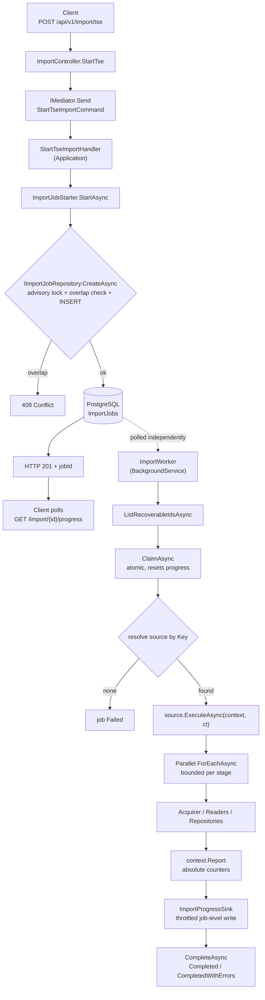

# Import Flow — How an Import Starts and Runs

This document describes the **current** import architecture: a durable job queue, a small
worker, and one import source per dataset provider. There is no per-work-unit persistence.

---

## 1. The flow at a glance



**Three independent moving parts:**

| Part | Lifetime | Class |
| --- | --- | --- |
| HTTP request | ~ms | `ImportController` → `StartTseImportHandler` → `ImportJobStarter` |
| Queue | durable row | `IImportJobRepository` |
| Execution | per job | `ImportWorker` → `IImportSource` |

---

## 2. Step by step

### Step 1 — HTTP entry (`Presentation`)

```csharp
[HttpPost("tse")]
public async Task<ActionResult<Result<ImportJobCreatedViewModel>>> StartTse(
    [FromBody] StartTseImportCommand command)
```

The controller only forwards to Mediator. The response is `201 Created` with the job id; the
request never waits for the import.

### Step 2 — Handler and starter (`Application`)

```csharp
public ValueTask<Result<ImportJobCreatedViewModel>> Handle(...)
    => new(starter.StartAsync(
        TseImportSource.SourceKey,
        TseImportSource.Scope,
        command.BatchSize, command.MaxAttempts, command.MaxParallelism,
        command.LeaseDurationSeconds, cancellationToken));
```

`ImportJobStarter` applies the configured defaults and creates the job row.

### Step 3 — Overlap protection (`Infrastructure`)

`ImportJobRepository.CreateAsync` runs one transaction:

1. `pg_advisory_xact_lock(hashtext('ImportJobs'))` serializes concurrent creates.
2. A `Pending`/`Running` job with the same `(Source, Scope)` makes the call return `false`.
3. Otherwise the job is inserted.

A partial unique index on `(Source, Scope)` filtered to active statuses is the durable backstop.

### Step 4 — Worker claims the job (`Presentation`)

`ImportWorker` polls every `Importing:Worker:PollIntervalSeconds` and, for each recoverable job:

- skips jobs already in flight in this process;
- respects `MaxConcurrentJobs` through a semaphore;
- calls `ClaimAsync`, which uses `FOR UPDATE SKIP LOCKED` so two workers can never claim the same
  job;
- resets `Stage`, operation counters and record counters for a fresh run.

### Step 5 — Source resolution and execution

```csharp
var source = sources.FirstOrDefault(candidate => candidate.Key == job.Source);
await source.ExecuteAsync(context, executionCts.Token);
```

The worker knows nothing about TSE or IBGE. A new provider is registered as an `IImportSource`
and becomes runnable without touching the worker.

### Step 6 — Progress, lease and cancellation

A heartbeat every `lease / 3` renews the lease and flushes progress. If renewal fails — the job
was cancelled or another worker took over — the heartbeat cancels the execution token, which
propagates into every download, read and upsert.

Progress is written by `ImportProgressSink`:

- counters are absolute job-level values, never deltas;
- writes are serialized, and a flush always ends with the newest snapshot;
- writes are throttled by `ProgressFlushMilliseconds`;
- a failing progress write is logged and never fails the import.

### Step 7 — Completion, failure, recovery

| Situation | Result |
| --- | --- |
| Source finishes | `Completed` (or `CompletedWithErrors` when dead letters exist) |
| Permanent exception | `Failed`, `LastError` set |
| Transient exception, attempts left | `Pending` with `NextAttemptAt` (exponential backoff + jitter) |
| Transient exception, attempts exhausted | `Failed` |
| Graceful shutdown | `Pending`, lease cleared |
| Crash | lease expires, job is listed as recoverable |
| Startup on the same machine | `ReleaseOwnedByAsync` releases jobs immediately |

Recovery always **restarts the whole job**. `ClaimAsync` resets progress and the source re-executes
every stage. This is safe because all persistence is idempotent (`ON CONFLICT … DO UPDATE`) and
dataset versioning prevents corrected archives from duplicating votes.

---

## 3. Where state lives

| Table | Rows | Meaning |
| --- | --- | --- |
| `ImportJobs` | 1 per import | status, stage, counters, lease, last error |
| `ImportFailedRecords` | 0..n per job | rejected source rows, unique per `(JobId, SourceIdentifier)` |
| `ImportDatasets` | 1 per acquired file | checksum-keyed provenance |
| `DatasetVersions` | 1 per imported scope | one active version per scope |

`ImportWorkUnits` no longer exists.

---

## 4. Concurrency policy

Configured under `Importing`; each source must not exceed the job's `MaxParallelism`.

| Stage | Mechanism | Default |
| --- | --- | --- |
| TSE references | `Parallel.ForEachAsync` over years | 2 |
| TSE candidates | `Parallel.ForEachAsync` over years | 2 |
| TSE results | `Parallel.ForEachAsync` over (year, state) | 3 |
| IBGE | sequential states → municipalities | 1 |

Stages are ordered (`references` → `candidates` → `results`) because each depends on the previous
one. Within a stage, operations are independent and run concurrently. There is no nested
parallelism and no unbounded fan-out of HTTP requests or database connections.

---

## 5. Extending with a new source

1. Implement `IImportSource` (`Key`, `ExecuteAsync`) in the appropriate Infrastructure project.
2. Register it: `services.AddScoped<IImportSource, MyImportSource>();`
3. Add an endpoint/command that calls `ImportJobStarter.StartAsync` with its key and scope.

The worker, the repository and the progress sink require no changes.

---

## 6. Configuration

```json
"Importing": {
  "DefaultBatchSize": 1000,
  "DefaultMaxAttempts": 3,
  "DefaultMaxParallelism": 3,
  "DefaultLeaseDurationSeconds": 120,
  "TseReferenceParallelism": 2,
  "TseCandidateParallelism": 2,
  "TseResultsParallelism": 3,
  "ProgressFlushMilliseconds": 1000,
  "RetryBaseDelayMilliseconds": 500,
  "RetryMaxDelayMilliseconds": 30000,
  "Worker": {
    "Enabled": true,
    "PollIntervalSeconds": 5,
    "MaxConcurrentJobs": 2,
    "MaxJobsPerPoll": 20,
    "RecoverOnStartup": true
  }
}
```

Set `Importing:Worker:Enabled=false` to enqueue without executing (integration tests do this).

---

## 7. Idempotency guarantees

Every write is an upsert keyed by a natural key: elections, rounds, offices, parties,
federations, coalitions, candidates, zones, sections, polling places, assignments, results and
IBGE localities. Candidates without a CPF are keyed by `(FullName, BirthDate)` so re-running does
not create new identities. Corrected TSE archives produce a new `DatasetVersion` that supersedes
the previous active one rather than duplicating votes.
